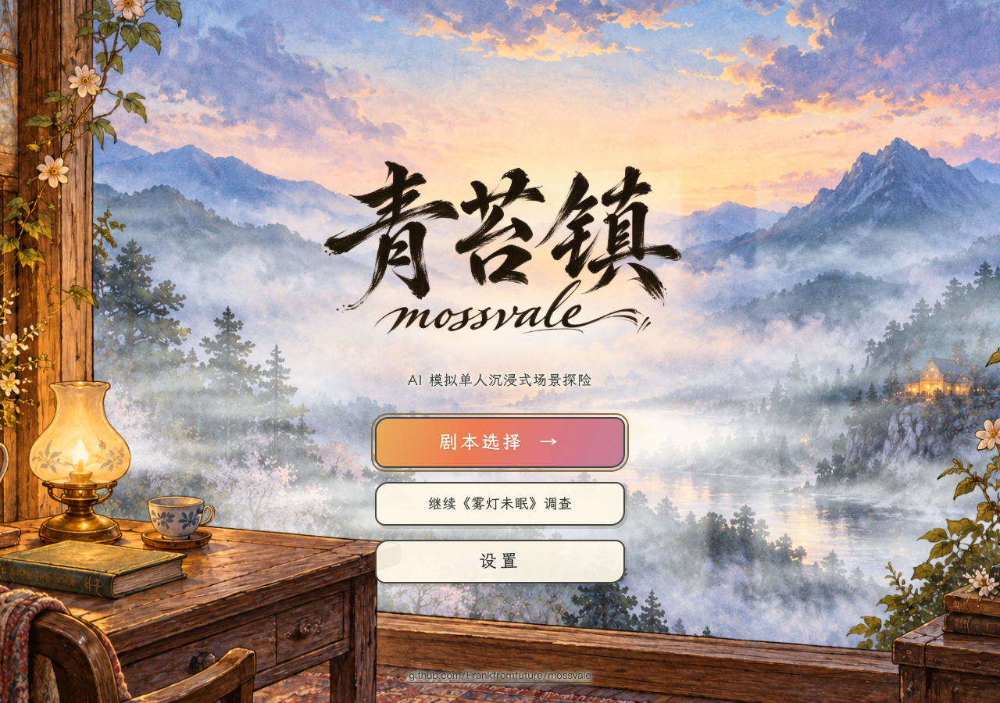

<p align="center">
  
</p>

# 青苔镇 Mossvale

当前版本 **0.8.3** · [完整更新记录](CHANGELOG.md)

青苔镇是一款由 AI 扮演人物的单人剧本杀。你走进一处手绘风格的 3D 场景，成为故事中的一个人：带着自己的经历和秘密，询问其他人、寻找物证、核对口供，再作出推断。

**[进入测试版 · www.iambrizo.com/mossvale](https://www.iambrizo.com/mossvale/)**

当前剧本《雾灯未眠》从一场山中怪谈开始。最后一支蜡烛熄灭，六个人各自藏起了一件事；天亮后重新围坐，却谁也不愿先说自己看见了什么。你要弄清昨夜发生的事，也要想好，别人问起你时该怎样回答。



## 走进故事，可以做些什么

**用自己的话追问。** 直接输入问题，或用语音开口，询问某人的去向、对某件物品的认识，以及他怎么看待另一个人；拿到新证据后，还可以回头核对先前的说法。人物会依照性格、经历与当前知情作答，也可能回避、记错或反问你。

**在场景中寻找依据。** 走进客房、花园与厅堂，点击描边物件搜证，将线索收进手记，再决定私下向谁出示、何时当众公开。公开物件后，在场人物会分别作出动作或台词反应，你可以接着追问。

**破案时也要保护自己。** 每位主角都有个人目标和保密事项，别人会根据听过的话盘问你；进房、翻找私物和查看本人线索各有许可，强行行动会影响成绩。调查既要核对他人的证词，也要照顾自己的解释和分寸。

**换一个人，重新理解同一晚。** 六位主角各有开场经历、已知信息、主线和个人支线。首次从白川澄开始，其他角色按最高结案调查分数解锁；换一个视角，会知道一些原本需要调查的事，也会面对另一组疑问与选择。

**按自己的节奏调查。** 每局有 360 行动点，问答与首次搜证消耗点数，行走、阅读和等待不消耗。案件推理、秘密保护、回答可信度、交谈分寸、调查规矩与行动效率共同构成调查成绩，扣分记录可以查看依据。

## 场景里的生活感

人物有不同的衣着、随身物件和声音，会走路、落座、添茶、翻书，也会与其他人闲谈或私下交谈。与你说话时，镜头会推近，眉眼、嘴巴和肢体随对白状态变化；语音播放时，口型跟随声音强弱。

画面采用细铅笔描边、淡色材质与纸页界面，配合圆润家具、流动河水和移轴效果。首页的窗框桌面与山谷分层漂移，探险音乐、轻咔嗒声、气泡音和纸张声为操作提供反馈；音量、音效和震动可在设置中调整。

桌面和手机浏览器均有对应布局。游戏按浏览器访客保存进度，同一访客下六位主角各有独立槽位，刷新后可继续；目前使用同一浏览器接续调查，跨设备账号同步尚未加入。

## 设计与创新

青苔镇把自由对话放在有证据约束的调查中。玩家可以自行组织问题，人物的可知事实、线索解锁、计分和结案条件由服务端规则管理，AI 负责将当前信息表达成人物的回答与动作。

- 每个人知道的事不同：人物的亲历、误解、已见证据和实际听闻分开记录，私谈只进入相应听众的上下文，同一件事可以得到不同说法，玩家需要自己核对。
- 问与答都会推动局面：NPC 会根据对话和搜证反问玩家，公开证据也会引出在场人物的反应，玩家需要随谈话调整调查方向。
- 角色扮演进入个人目标：六主角共用案件与场景，各自的初始信息、秘密和个人决定不同，重玩时会改变你想问的问题和愿意说出的内容。
- 规则接住生成内容：人物回复附带引用的事实编号，逐句核对后显示，评分结合原话依据，行动请求按编号去重，让重试、续档和自由对白衔接到同一份调查进度。

## 技术如何支撑这些玩法

| 部分 | 实现 |
| --- | --- |
| 3D 场景 | Three.js 与 WebGL 绘制人物、建筑、家具和河流，程序材质、轮廓线与移轴后处理形成手绘观感 |
| 人物与移动 | 共用墙体和家具障碍数据进行寻路，场景状态驱动行走、落座、闲动作、表情和对话镜头 |
| 人物对话 | DeepSeek 接收当前角色的性格、可知事实、已见证据和谈话上下文，生成带事实引用的回答，经校验后通过 SSE 逐句传到页面 |
| 语音 | Qwen 负责语音识别与流式合成，人物名使用热词，各角色固定音色；WebSocket 传输音频，浏览器分段播放 PCM |
| 玩法与存档 | Node.js 服务管理调查、许可、盘问、评分和结案，JSON 存档按访客及角色槽位保存，并为旧格式迁移保留备份 |
| 界面与构建 | 原生 JavaScript 模块、CSS、自适应 SVG 与内置楷体实现纸页和对话界面，esbuild 打包前端 |

人物扮演与回答判定分别组织上下文：扮演请求按该人物此刻可知的信息回答，判定请求结合玩家原话处理泄密、矛盾与盘问结果。模型密钥由服务端读取，网页只接收游玩所需的内容。

玩法细节可查看 [调查与评分](mystery/docs/investigation.md)、[六主角设计](mystery/docs/six-protagonists.md)和[开始菜单与角色解锁](mystery/docs/start-menu.md)，历次上线范围见[部署记录](mystery/deploy/README.md)。

## 本地运行

使用 Node.js 22 或更新版本，在项目根目录执行：

```sh
npm run setup
npm run build
npm start
```

然后打开 [http://127.0.0.1:4331/](http://127.0.0.1:4331/)。

人物对话使用 DeepSeek，服务从 `DEEPSEEK_API_KEY` 环境变量读取密钥；`DEEPSEEK_BASE_URL` 和 `DEEPSEEK_MODEL` 可指定服务地址与模型。语音识别和朗读使用 Qwen，通过 `DASHSCOPE_API_KEY` 配置。环境变量由启动环境注入，程序不会自动读取 `.env` 文件。

本机已有 Brizo 配置时，macOS 启动器也支持读取该配置。密钥保留在服务端，本地存档写入 `mystery/.data/`。

## 项目结构

| 目录 | 内容 |
| --- | --- |
| `mystery/src/` | 3D 场景、人物表现和交互界面 |
| `mystery/server/` | 调查规则、角色存档、AI 对话与语音服务 |
| `mystery/shared/` | 前后端共用的布局与规则 |
| `mystery/public/` | Logo、场景图片、字体和音频 |
| `mystery/art/` | 美术来源、生成提示词与源素材 |
| `mystery/docs/` | 玩法与实现说明 |
| `mystery/deploy/` | 部署与版本记录 |

根目录的 npm 命令统一转交给 `mystery/`。仓库当前维护 AI 剧本杀，早期 AI 小镇的 2D、3D 和微信工程已在本地归档，旧版本仍可从 Git 历史查看；玩家存档、本地验证数据和归档压缩包留在本机。

## 版本维护

每次请求完成后更新版本号与一句话改动记录：主要功能和玩法升级递增次版本，小修复、界面微调和文档更新递增补丁版本。包版本、README、[CHANGELOG](CHANGELOG.md)、Git 标签与 Release 同步维护，执行规则保存在 [mystery/AGENTS.md](mystery/AGENTS.md)。
