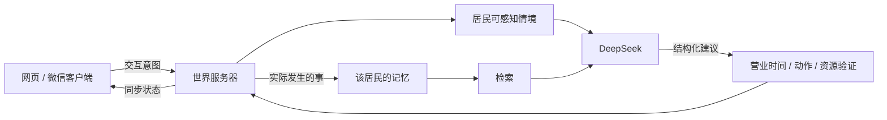

# 从 Generative Agents 到苔溪镇

核查日期：2026-10-11。本文区分论文结论、项目设计和本轮已完成的原型。

## 研究给了我们什么

《Generative Agents: Interactive Simulacra of Human Behavior》把观察、记忆、反思和规划连在一起。在 25 名居民的 Smallville 中，一条举办情人节聚会的想法逐渐变成邀请、交流和赴约。检索综合近期程度、重要度与相关性；反思从经历中归纳认识，并把依据指向原始记忆。消融实验支持这些模块对行为可信度的贡献。

值得沿用的是这套循环。论文也记录了记忆幻觉、过度礼貌、过分配合和人格受他人意见牵引的问题。实验主要覆盖两个游戏日，长期稳定和规模成本仍需另做验证。苔溪镇因此把执行权留给程序：居民可以说想去哪里，世界规则决定是否营业、如何走到、何时到达。模型台词不直接改写事实。[论文全文](https://arxiv.org/html/2304.03442v2)

| 研究 | 核查结果 | 对苔溪镇的工程选择 |
| --- | --- | --- |
| LLM Agents Grounded in Self-Reports Enable General-Purpose Simulation of Individuals | 原题为 Generative Agent Simulations of 1,000 People。2026-06-28 的 v3 使用 1,052 名美国参与者的数据，比较访谈、问卷及二者结合 | 人设补充经历、价值观、愿望与矛盾。虚构角色使用人工背景，不收集现实人物访谈 |
| InCharacter，ACL 2024 | 通过心理访谈和人格量表评价角色扮演的人格忠实度 | 用被拒绝、借钱、失约等情境检查选择，而非只检查口头禅 |
| A-MEM，2025 | 用具有属性和连接的记忆组织新经验，允许后续经验更新记忆关联与解释 | 保存原事件；“他不重视我”作为附有依据的印象，允许以后改变 |
| PersonaForge: Psychology-Grounded Dual-Process Architecture for Personality-Consistent Role-Playing Agents | 核对到作者维护的项目仓库，介绍三层人格与选择性双过程机制；此处以作者仓库为依据，未独立复现其指标 | 稳定人格与即时情绪分离；第一版保留结构约束，复杂推理留给冲突事件 |
| AI Town | 工程参考将世界引擎、游戏逻辑和异步 AI 操作分层 | API 等待不承担动画循环。正式多人版使用后台队列，持久化操作状态 |

来源：[千人研究 v3](https://arxiv.org/abs/2411.10109v3)、[InCharacter](https://aclanthology.org/2024.acl-long.102/)、[A-MEM](https://arxiv.org/abs/2502.12110)、[PersonaForge 作者仓库](https://github.com/fQwQf/PersonaForge)、[AI Town 架构](https://github.com/a16z-infra/ai-town/blob/main/ARCHITECTURE.md)。这些工程选择是本项目的取舍，不是论文对本游戏的效果保证。

千人研究有一处版本差异需要记住：v3 报告访谈、问卷、组合代理的 GSS 留出题准确率，分别相当于参与者自身两周复测一致性的 83%、82%、86%，人口属性基线为 74%。这些数值衡量特定预测任务，没有“复制了某人多少人格”的含义。早期版本广为传播的 85% 也应附带它的版本和归一化口径。[v3 摘要与修订历史](https://arxiv.org/abs/2411.10109v3)

另外存在一篇同名的 PersonaForge: Realistic Multi-Turn User Simulation for Agentic Systems（2026-08），研究的是用户与代理的多轮任务模拟。它与本项目引用的人格一致性架构不是同一项工作。[同名论文](https://arxiv.org/abs/2608.28378)

## 居民为什么会作出不同选择

林夏想让咖啡馆热闹起来，但收入有限。许知远想交朋友，也害怕在人群里被忽略。陈默愿意帮忙修东西，却对没有兑现的承诺很敏感。一个下午茶邀请因此既能产生合作，也可能遇到迟疑或拒绝。

人物数据分为稳定设定和会变的状态。稳定设定包括五项人格倾向、背景、说话方式与愿望；状态包括当前地点、日程、心情、精力、饥饿和关系。本轮五项人格只是设计参数，未声称完成心理量表测量。

模型每次收到本人的设定、可感知环境、最近几轮交谈和七条以内相关记忆。其余居民的私有记忆不参与上下文构建。观察者可以在档案里阅读各人的故事，居民自身没有全知视角。

事件、印象、承诺分别保存。例如一次失约会成为客观事件；“我需要再观察你”是居民的看法；下一次下午茶是有日期的承诺。道歉增加一点信任，原失约事件仍在。第一版的信任增量由规则确定，避免一句模型输出把关系从陌生直接改成挚友。

## 当前原型与正式架构

本轮实现网页游戏、本机服务和原生小程序客户端。网页方便先验证行为循环；小程序用原生视图、图片与 wx.request 展示同一世界。地图背景由 ImageGen 生成，路点和角色位置是独立数据。

正式版本建议把世界模拟、记忆检索和 AI 调用保留在云端。客户端只发送交互意图，接收经过验证的状态；后续换成 Cocos Creator 2D 时也可沿用协议。Cocos 的官方流程可构建微信小游戏项目并接入开发者工具；本轮没有创建或导出 Cocos 工程。[Cocos 微信小游戏发布文档](https://docs.cocos.com/creator/3.8/manual/en/editor/publish/publish-wechatgame.html)

上线阶段再把本地 JSON 换为 PostgreSQL，按需要引入 pgvector，AI 任务放入持久队列。每个居民同一时刻只执行一个决策，结果携带世界版本；过期结果作废，不重复扣钱或赴约。当前单进程原型在互动期间短暂暂停世界推进，减少第一次验证所需的并发复杂度；这是明确的产品取舍。

## 成本怎么估

先测一个小镇。账单应拆成玩家交流、自主反思、记忆整理和重试。动画、行走与日程用程序执行，离线补算也不调用模型。

本轮小镇每日最多 80 次调用、每次最多 420 输出 token。若均摊输入为 2,000 token，则每日为 160,000 输入与最多 33,600 输出 token。按服务商当时的每百万价格，模型费为 `0.16 × 输入单价 + 0.0336 × 输出单价`。这里不复用历史价格，也不把 token 上限当成实付账单。界面显示实际 API 返回的 token 用量。

本机进程的全局限制为每日 400 次，重启会重置。公开内测前应把预算、重试和并发配额存入数据库，以用户和小镇为单位结算。超限后保留既定日程，只对当前玩家正在参与的场景分配调用。

## 6—8 周如何推进

这是两名开发者加兼职美术的工程估算，未包含平台审核。

| 阶段 | 工作 | 通过条件 |
| --- | --- | --- |
| 第 1 周 | 三人咖啡馆、人格场景、存档与记忆检索 | 帮助与失约能改变后来行为；重启后保留经历 |
| 第 2—3 周 | 12 人调度、路径、关系、事件队列 | 运行 7 个游戏日；承诺不重复结算；故障可恢复 |
| 第 4—5 周 | Cocos 或原生小程序前端、登录、HTTPS、断线恢复 | 微信真机验证；渲染与 API 延迟互不阻塞 |
| 第 6—8 周 | 约 20 人封闭内测、内容审核、成本与删除功能 | 人格差异可辨认，故事可追溯，预算可预测，玩家愿意回来 |

内测不要只问“像不像人”。先让三个人分别面对同样的借钱、拒绝和失约场景，记录他们引用了什么经历、选择了什么行为；七个游戏日后再问同一件事。秘密边界、重复扣款、重叠承诺和 API 失败也要各留一个可复现案例。长期效果在这些证据积累前保持“待验证”。
